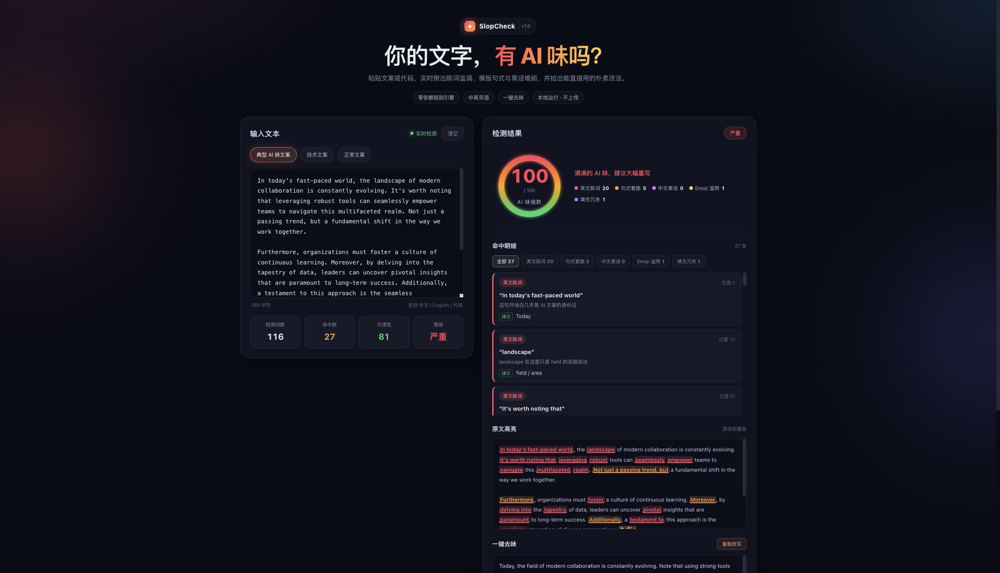

<div align="center">

[English](README.md) | [中文](README-zh.md)

🧹

# SlopCheck — AI Text Detector for English & Chinese

▶ **[Try it live](https://webxiongda.github.io/slopcheck/)** — no install, runs in your browser.

**Find the AI-ness in your writing — in your browser, in real time, without sending a single character anywhere.**

[](https://github.com/webxiongda/slopcheck)
[](LICENSE)
[](https://github.com/webxiongda/slopcheck/pulls)
[](https://react.dev/)
[](https://www.typescriptlang.org/)

</div>

<div align="center">
  
</div>

## Why SlopCheck?

AI-assisted writing has a recognizable accent. It reaches for *delve into*, *seamless*, *it's worth noting*, and *not just X, but Y*; in Chinese it leans on 赋能 / 抓手 / 闭环. None of these words are wrong on their own, but together they make prose feel generated — polished, generic, and oddly bloodless. The reaction is visible in the tooling landscape: anti-slop projects such as impeccable (+15.2k/mo), unslop (+15.1k/mo), and hallmark (+14.1k/mo) have surged at the same time, which says people want a fast way to spot and strip out these tells.

Most detectors are either cloud services that upload the very text you are uneasy about, or black-box scores with no explanation of what went wrong. SlopCheck takes the opposite route: a fully local, zero-dependency rule engine that shows exactly which phrase triggered a hit, why it reads as templated, and what plainer wording would work instead.

The goal is editing, not judging. The 0–100 score is a rough signal, not a verdict; the evidence is highlighted in place; and the final decision always stays with you. No account, no API key, no network request — just your text and a set of rules you can read and extend.

## Features

| Feature | Description |
| --- | --- |
| Local & private | Everything runs in the browser. No model calls, no backend, no telemetry — text never leaves your device. |
| 0–100 AI-ness score | Weighted-density scoring with four bands (clean / mild / medium / severe) and an SVG gauge. |
| Five match categories | English clichés, formulaic patterns, Chinese buzzwords, emoji abuse, and filler — color-coded inline. |
| Zero-dependency rules | 66 plain TypeScript regex + wordlist rules; no runtime dependency beyond React and React DOM. |
| Actionable suggestions | Every hit explains itself and offers a plainer substitute; most can be applied with one click. |
| One-click de-slop | Auto-rewrite replaces clichés and filler, capitalizes sentence starts, and copies the result. |
| Strict mode | Drops the repetition threshold for discourse markers and raises the density factor for formal copy. |
| Batch detection | Paste multiple blocks, sort by score / hits / readability, and export results to CSV. |
| Before/after & share card | Compare original and rewritten text side by side, or copy a text card with the score and top 3 hits. |
| Bilingual coverage | Catches both English filler ("delve into", "in order to") and Chinese jargon (赋能, 底层逻辑, 颗粒度). |

**🔗 Live demo:** https://webxiongda.github.io/slopcheck/

## Quick Start

```bash
git clone https://github.com/webxiongda/slopcheck.git
cd slopcheck
npm install && npm run dev
```

Open `http://localhost:5173` and paste text into the workbench — analysis starts as you type. For a static build, run `npm run build` followed by `npm run preview`. Run the test suite with `npm test`.

## Pages

The app uses hash routing, so every page is linkable and works when embedded in an iframe.

| Hash | Page | What it does |
| --- | --- | --- |
| `#/analyze` | Analysis workbench | Paste text, see the live score, filter hits by category, rewrite, and copy a share card. |
| `#/rules` | Rule browser | Search and filter all 66 rules by pattern, reason, or suggested fix. |
| `#/history` | Detection history | Review local records and reload any entry back into the workbench. |
| `#/compare` | Before / after | Inspect original and de-slopped text side by side with the score delta. |
| `#/batch` | Batch detection | Split input on `---`, sort the result table, and export CSV. |
| `#/examples` | Examples & favorites | Try three built-in samples or keep your own locally saved favorites. |
| `#/stats` | Statistics | SVG gauge, bar, pie, and line charts over detection history. |
| `#/guide` | Guide | Four-step walkthrough, five categories, and the score bands explained. |
| `#/about` | About & trends | Why de-slopping matters, the evidence behind it, and project links. |
| `#/settings` | Settings | Toggle auto-save, highlighting, and strict mode; manage local data. |

## How it works

Each rule in [`src/rules.ts`](src/rules.ts) declares a `source` regex, `flags`, a `category`, and a plain-language `reason` / `suggestion` (plus an optional `replacement` and `minCount`). The analyzer compiles a fresh `RegExp` per rule to avoid shared `lastIndex` state, then runs overlap dedup so a span is never scored twice — at the same start position, the longer match wins. The score is a weighted density: the sum of category weights (pattern 6, emoji 4, cliché/chinese 3, filler 2) divided by the token count with a floor of 24, scaled by 132 (or 168 in strict mode), and clamped to 0–100 with thresholds at 15, 40, and 70. De-slopping applies replacements back-to-front so earlier offsets stay valid, capitalizing at sentence starts. Charts are hand-drawn SVG; state is persisted in `localStorage` with a `JSON.parse` fallback so a corrupted value can never blank the app.

## Tech Stack

React 18 and TypeScript in strict mode, built with Vite. The rule engine has **zero extra runtime dependencies** — just regular expressions and wordlists. Routing is a small hash router; charts are hand-written SVG; persistence is `localStorage`. React and React DOM are the only runtime packages.

## Documentation

- [中文文档](README-zh.md) — full Chinese translation of this guide.
- [CONTRIBUTING.md](CONTRIBUTING.md) — how to run locally and send a pull request.
- [LICENSE](LICENSE) — MIT.

## Contributing

Pull requests are welcome, especially additions to the rule tables. Rules live in a single file, so a good first contribution is a new cliché, a Chinese buzzword with a natural replacement, or a clearer suggestion for an existing hit. Other useful work: edge cases in overlap dedup, more readable SVG charts, and documentation improvements. Please keep changes small and focused, and open an issue first for larger refactors. See [CONTRIBUTING.md](CONTRIBUTING.md) for conventions.

## Roadmap

- [ ] Expand the wordlists to cover more genres (academic, marketing, product copy).
- [ ] Add optional per-category sensitivity controls in Settings.
- [ ] Add import / export of rules and favorites as JSON.
- [ ] Improve readability heuristics beyond average sentence length.
- [ ] Add a small test suite for analyzer edge cases.

## License

[MIT](LICENSE) © SlopCheck contributors.
